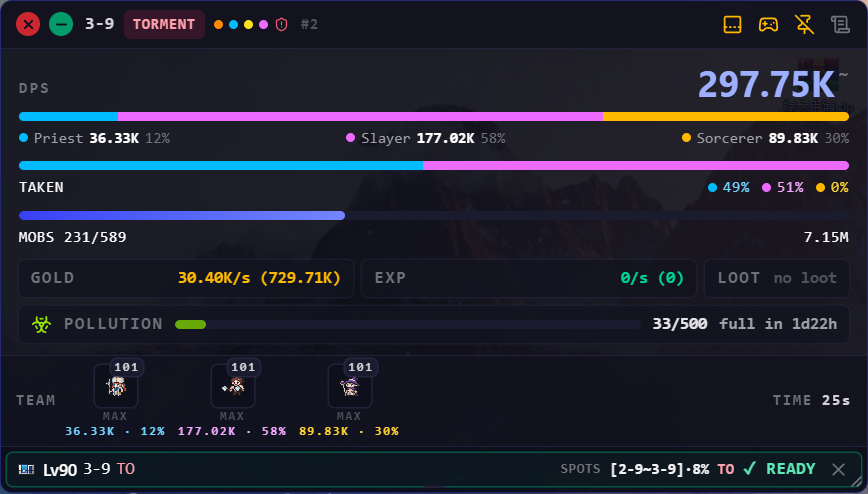
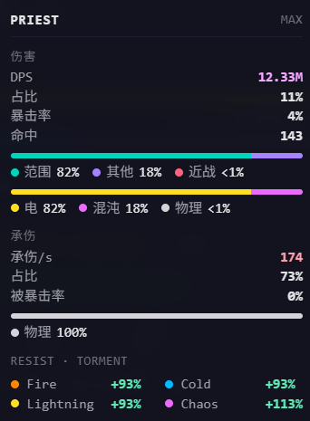
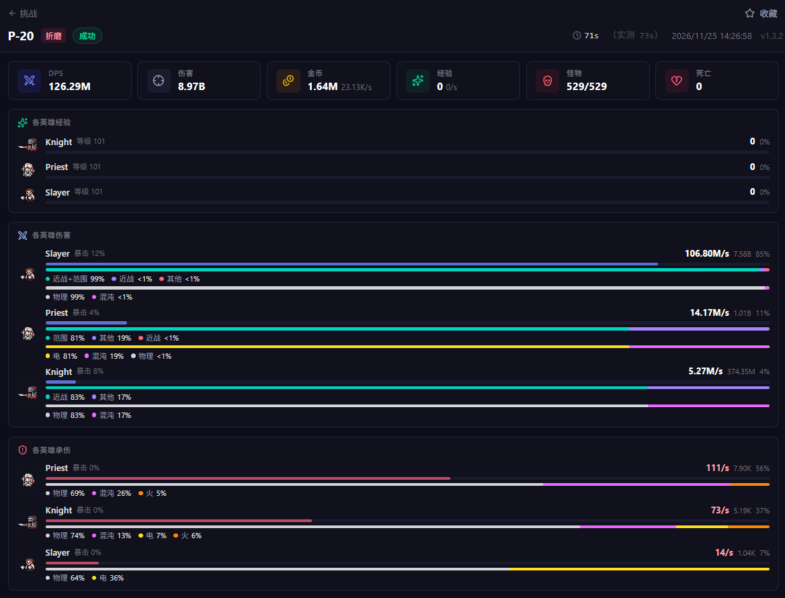
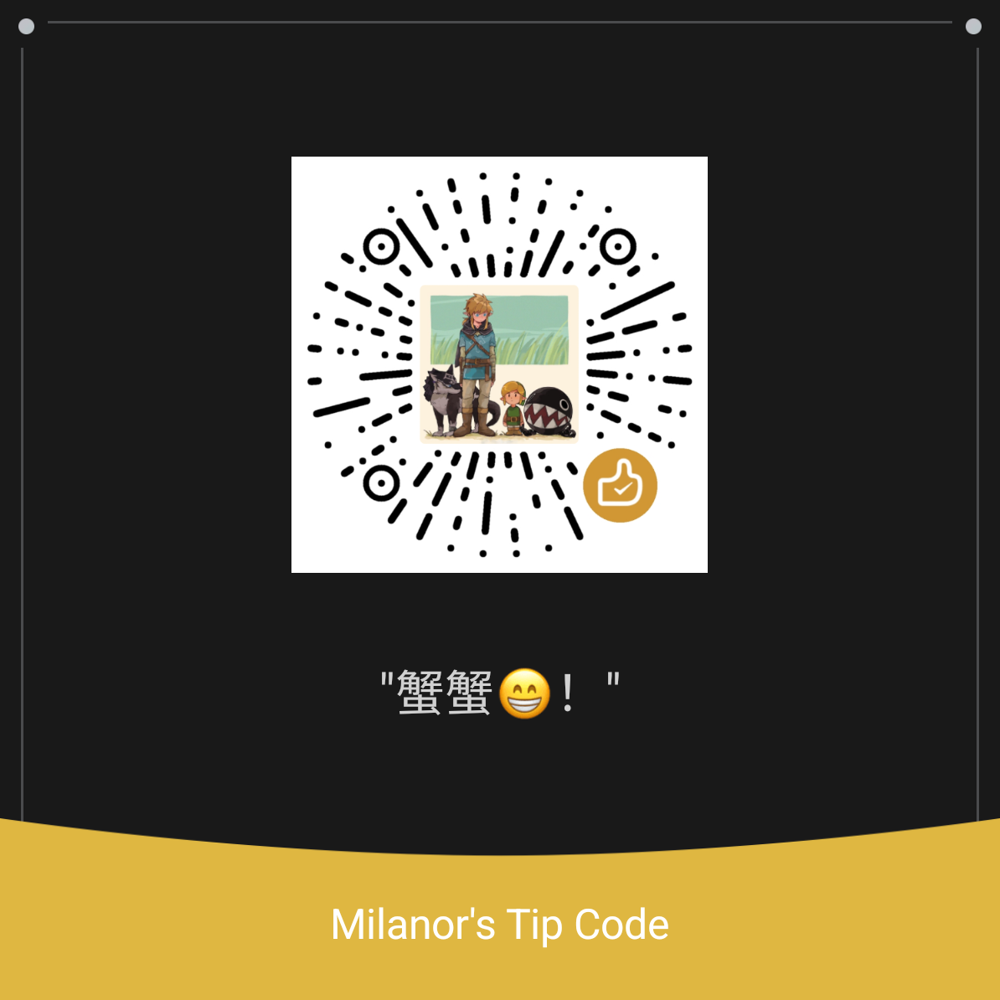

<div align="center">

# TBH Meter — 1.3.2 Edition

**Live DPS / Gold / EXP overlay and run tracker for Task Bar Hero, updated for game 1.3.2 — now with per-hero DPS.**

[](https://github.com/Reyn4Bo/tbh-meter/releases)
[](#whats-new-in-this-edition)
[](https://github.com/Reyn4Bo/tbh-meter/releases)
[](./LICENSE)

&nbsp;&nbsp;

_Unofficial edition of [mad-labs-org/tbh-meter](https://github.com/mad-labs-org/tbh-meter) — not made by or endorsed by the game's developer or the original authors._

</div>

---

**中文简介：** 这是 TBH Meter 的非官方修改版，适配 Task Bar Hero **1.3.2**，新增**每个英雄的 DPS / 承伤 / 伤害类型 / 元素伤害分布统计**（可选功能，默认关闭）、**瘟疫之地污染度显示与满值提醒**、**污染宝箱冷却追踪**（蓝箱冷却按 1.3.2 实测改为约 3 分钟），修正了抗性、击杀数等显示问题，并支持隐藏 meter 和游戏本体的任务栏图标。安装包在 [Releases](https://github.com/Reyn4Bo/tbh-meter/releases) 页面下载，Windows 10 以上，无需管理员权限；从 0.45.0 起会自动更新（只更新到本仓库发布的版本）。

## What's new in this edition

### 1. Works with Task Bar Hero 1.3.2

The upstream meter targets an older game build; on 1.3.2 gold, stage, party and XP stopped reading. This edition:

- re-maps every field that moved in 1.3.2 (including the obfuscated ones the automated diff misses) and verifies them against the running game — all 13 live checks pass;
- reads the reworked stage log and handles the removed `DeadMonsterUnit`;
- regenerates the item, stage and hero data from the 1.3.2 game files (new contaminated / plague stages and items included);
- ships a fresh calibration seed, so the first launch attaches in ~10–30 seconds instead of a 1–2 minute scan;
- **fixes the stage showing `?` after a game restart:** the meter no longer attaches to a game that is still loading. It waits for it instead, and fills in anything a half-loaded scan missed.

### 2. Per-hero DPS, damage taken, damage types and elements _(optional)_

The original meter only knows team DPS: memory alone cannot tell which hero landed a hit. This edition adds an **opt-in** in-game observer that credits every hit to the hero (or summon owner) that dealt it:

| Where | What you get |
| ----- | ------------ |
| **Overlay** | Per-hero DPS and share bar; damage-taken share (who is tanking); per-hero DPS under each portrait |
| **Hero tooltip** | DPS, share of team damage, crit rate, hit count, damage type and **element** breakdown (physical / fire / cold / lightning / chaos); damage taken per second, share and element breakdown |
| **Run detail** | _Damage by hero_ (DPS, total, share, crit, type and **element** breakdown) and _Damage taken by hero_ (by element) |

<div align="center">

</div>

Mixed-damage heroes show their element split — e.g. a Priest with a chaos relic: lightning 81% · chaos 19%. The numbers reconcile exactly with the meter's own team damage (ratio **1.000** across multiple runs and party compositions, summons and relic "extra damage" effects included). It costs essentially nothing: the plugin only adds counters per hit and writes a small file once a second.

**How it works — and what it changes.** It is **off by default**; without it the meter remains a pure read-only memory reader that never touches the game folder. Turning on **Settings → Per-hero DPS** (with the game closed) installs [BepInEx 6](https://github.com/BepInEx/BepInEx) (LGPL-2.1) plus a small plugin into the game folder. The plugin hooks the game's "take damage" calls, **only observes them** (it never changes a game value and does not touch the anti-cheat) and writes cumulative counters to `%USERPROFILE%\tbh-meter-mod\combat.json`, which the meter reads. Turning the option off removes exactly what was installed — except that if you have since added other BepInEx mods, BepInEx itself is kept for them and only this plugin is removed.

> [!WARNING]
> Loading a plugin into the game **is a game modification**. The game has online features (trading, Steam market) and an anti-cheat library; a flag/ban risk cannot be ruled out. Check the game's terms and decide for yourself before enabling it. Source and details: [`mod/`](./mod).

### 3. Accuracy fixes

- **Resistances** — affixes that change several resistances at once (and "decrease" stats) are now applied, so the shown values match the in-game stat sheet.
- **Kill totals** — the stage total now subtracts the _wave-reduction_ runes from the talent tree (e.g. 553 instead of the raw wave count).
- **Dead heroes** — keep their last-known stats, greyed out with a skull, instead of disappearing from the party.
- **Layout** — the DPS, damage-taken and mobs bars line up edge to edge.

### 4. Plaguelands pollution and chest cooldowns

- **Pollution gauge** — the overlay shows the account's Plaguelands pollution (e.g. `33/500`) and the time until it is full. When it reaches the max, a card appears under the overlay and Windows sends a notification (can be turned off in Settings → Notifications).
- **Contaminated stage box** — the Plaguelands boss chest gets its own cooldown card, countdown and "ready" notification (it used to be counted as a blue chest), plus its own drop notification.
- **Re-measured cooldowns** — on 1.3.2 the blue chest can drop again after about **3 minutes** (measured over 186 clears), not 13; the contaminated box defaults to **3.6 minutes** (the game's own 360/300 ratio). Both are adjustable in Settings.
- **Exact chest in run history** — each drop shows the real box of that stage (contaminated, Halloween…).
- **Overlay** — drag the bottom-right corner to change width and scale together; new installs are no longer always on top (toggle it with the pin button).

### 5. Hide taskbar icons

Both the meter and the game are idle-in-the-background apps. You can hide **the meter's** taskbar icon (the tray icon stays) and **the game's** taskbar icon — from Settings or with the two buttons in the overlay title bar. Hiding the game's icon is a plain Windows-shell call (`ITaskbarList`); it does not touch the game's memory or files, and the icon comes back when you turn it off or quit the meter.

## Install

> **Windows 10+ only.**

1. Download **`tbh-meter-rc-Setup-<version>.exe`** from [**Releases**](https://github.com/Reyn4Bo/tbh-meter/releases).
2. Run it — **no admin rights needed** (installs per-user as **tbh-meter-rc**, side by side with any official install).
3. Start Task Bar Hero and the meter in any order; live stats appear after the first attach.

**Auto-update is on — from this repository only.** Since 0.45.0 the meter updates itself to new releases published here, never to the original project. Coming from rc.7 / rc.8 (auto-update off), install the latest release manually once.

<details>
<summary><b>"Windows protected your PC" warning</b></summary>

The installer is **not code-signed**, so SmartScreen warns on first run. Click **More info → Run anyway**.
</details>

<details>
<summary><b>Antivirus flags <code>tbh-reader.exe</code></b></summary>

A **false positive**: `tbh-reader.exe` is the bundled game reader. It only *reads* memory and never writes to the game. Allow or restore it so the meter can work.
</details>

## How it works

```
 Task Bar Hero (game process)
        │  ReadProcessMemory (read-only)            ┌─ optional: BepInEx observer plugin (mod/)
        ▼                                           │  writes per-hero combat.json
 reader/  ──►  tbh-reader.exe   ◄───────────────────┘
        │      pure-Python sensor: resolves IL2CPP classes, writes a run record
        ▼      per finished run + a live feed
 app/     ──►  tbh-meter (Electron)  overlay + runs list + run detail
```

- **`reader/`** — the memory reader. Pure `ctypes` + stdlib, frozen into one `tbh-reader.exe` with PyInstaller. Read-only.
- **`app/`** — the Electron overlay: live overlay, runs list and detail, settings, plugin installer, taskbar options.
- **`mod/`** — the optional per-hero combat plugin (C#, BepInEx 6 IL2CPP).

Everything stays local: runs are files in `~/tbh-meter-rc/` and never leave your machine.

## Build from source

You need **Node 22 + pnpm** (app), **Python 3.12** (reader) and, for the optional plugin, the **.NET 6+ SDK**.

```bash
# App (Electron overlay)
cd app
pnpm install
pnpm check && pnpm test

# Reader (Python sensor)
cd reader
pip install ruff -r requirements-dev.txt
ruff check . && python -m pytest

# Optional plugin + installer packaging: see mod/README.md
```

## Support this edition

**⭐ The easiest way to help: star this repo!** It's free, it keeps the 1.3.2 edition easy to find for other players, and it tells me the work is worth keeping up with future game updates.

If you'd like to buy me a coffee for the 1.3.2 port and the per-hero DPS work, that's hugely appreciated too — every bit goes into keeping this edition updated.

**如果觉得好用，请先点个 ⭐ Star！** 这是最简单的支持方式，也能让更多玩家找到这个版本。想请我喝杯咖啡的话，也非常感谢 —— 会用来持续跟进游戏更新。

<div align="center">

[](https://buymeacoffee.com/milanory)

<br>
<sub>微信赞赏码 · WeChat tip code</sub>

</div>

## Credits & original project

This edition is built on **[TBH Meter](https://github.com/mad-labs-org/tbh-meter)** by **[Mad Labs](https://github.com/mad-labs-org)**. The overlay, the run tracker, the memory reader and its calibration system are their work; this edition updates it for game 1.3.2 and adds the features above. Please don't report issues with this edition to the original project.

If the meter helps your runs, consider supporting the original authors:

<div align="center">

[](https://buymeacoffee.com/viniarruda)

</div>

## License

[MIT](./LICENSE) — © Mad Labs (original project); modifications in this edition are released under the same license. The bundled BepInEx is LGPL-2.1 ([full text](./mod/LICENSE-BepInEx-LGPL-2.1.txt)). Task Bar Hero and its assets belong to their respective owner.
